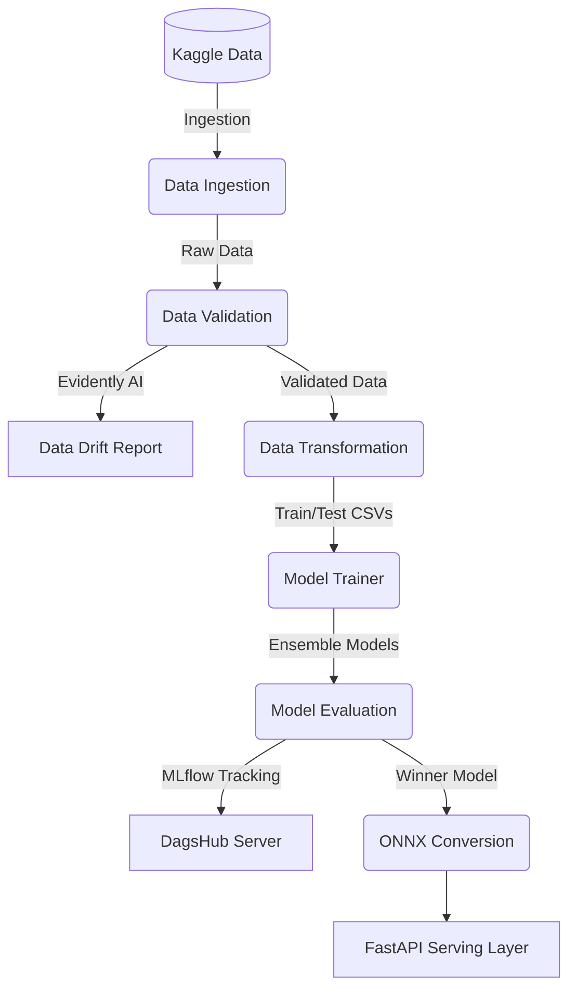

<div align="center">
  <pre>
  _______  _                  _____ _                     
 |__   __|| |                / ____| |                    
    | |___| | ___ ___ ______| |    | |__  _   _ _ __ _ __ 
    | / _ \ |/ __/ _ \______| |    | '_ \| | | | '__| '_ \
    | \__ / | (_| (_) |     | |____| | | | |_| | |  | | | |
    |_|___|_|\___\___/       \_____|_| |_|\__,_|_|  |_| |_|
  </pre>
  <h1>🚀 Telco Customer Churn Prediction (End-to-End MLOps)</h1>
  <p><i>A Production-Grade Machine Learning Pipeline using FastAPI, ONNX, DagsHub, MLflow, Docker, and DVC</i></p>
  
  [](https://www.python.org/)
  [](https://fastapi.tiangolo.com/)
  [](https://dvc.org/)
  [](https://mlflow.org/)
  [](https://www.docker.com/)
  [](https://evidentlyai.com/)
  [](https://github.com/features/actions)
</div>

---

## ✨ Features Checklist
- [x] **Automated Data Ingestion:** Fetches data directly from Kaggle.
- [x] **Robust Data Validation:** Validates schema and detects **Data Drift** using `Evidently AI`.
- [x] **DVC Orchestration:** Intelligently caches and tracks the entire pipeline DAG.
- [x] **Model Ensemble:** Tests Random Forest, XGBoost, and Logistic Regression.
- [x] **Experiment Tracking:** Fully integrated with MLflow & DagsHub.
- [x] **ONNX Acceleration:** Model converted to ONNX for blazing-fast inference.
- [x] **FastAPI UI/API:** Beautiful HTML templates & high-performance API.
- [x] **Automated CI/CD:** GitHub Actions workflow powered by `uv` for instant testing and training.

---

## 📂 Professional Directory Structure

```text
📦 telco_customer_churn
 ┣ 📂 artifacts/              # Ignored by Git, tracked by DVC (Data/Models)
 ┣ 📂 config/                 # YAML configurations (schema, params)
 ┣ 📂 customer_churn/         # Core Application Code
 ┃ ┣ 📂 components/           # ML logic (Ingestion, Transformation, etc.)
 ┃ ┣ 📂 pipline/              # DVC Pipeline Stage Runners
 ┃ ┗ 📂 entity/               # Dataclasses & Types
 ┣ 📂 logs/                   # Time-stamped execution logs
 ┣ 📂 templates/              # FastAPI HTML UI
 ┣ 📂 tests/                  # Pytest automated testing suite
 ┣ 📜 dvc.yaml                # Pipeline execution graph
 ┣ 📜 app.py                  # FastAPI Application Entry
 ┣ 📜 Makefile                # Centralized task management
 ┗ 📜 pyproject.toml          # Project dependencies (managed by uv)
```

---

## 📖 Overview

This repository demonstrates a complete, highly optimized, and automated Machine Learning Operations (MLOps) pipeline. It predicts customer churn in the telecommunications sector using historical customer data.

This repository demonstrates a complete, highly optimized, and automated Machine Learning Operations (MLOps) pipeline. It predicts customer churn in the telecommunications sector using historical customer data.

The project bridges the gap between raw data and a **highly optimized, served model**. It emphasizes automation, reproducibility, robust validation (Data Drift), and rapid deployment.

---

## 🏗️ Architecture & Component Deep Dive

The pipeline is managed by **DVC (Data Version Control)** to ensure that every stage is tracked, cached, and fully reproducible.



### 1. Data Ingestion 📥
Programmatically connects to Kaggle to fetch the dataset. 
- **Automated**: Ensures pipeline runs completely unattended in CI/CD.
- **DVC Tracked**: Raw data is cached locally in `artifacts/data_ingestion`.

### 2. Data Validation & Drift Detection 🛡️
Validates the dataset against a strict schema (`config/schema.yaml`).
- **Data Drift Detection**: Integrates **Evidently AI** to perform deep statistical comparisons on the incoming data, generating rich HTML/JSON reports (`drift_report.html`) to catch silent ML failures.

### 3. Data Transformation ⚙️
Converts raw data into machine learning-ready formats.
- **Pipelines**: Imputes missing values, applies `StandardScaler` to numericals, and `OneHotEncoder` to categoricals.
- **Artifacts**: Saves the precise `preprocessor.pkl` to guarantee identical scaling during live user inference.

### 4. Model Training & Selection 🧠
Trains an ensemble of powerful classifiers: **Random Forest, XGBoost, and Logistic Regression**.
- **Dynamic**: Pulls hyperparameters from `config/params.yaml`. The best performing model automatically advances.

### 5. Model Evaluation & ONNX Conversion 🏆
- **Experiment Tracking**: Logs metrics (accuracy, precision, recall, F1) to **DagsHub** and **MLflow**.
- **ONNX Optimization**: Converts the Scikit-learn/XGBoost model into an **ONNX (Open Neural Network Exchange)** graph. 
  > [!TIP]
  > Using `onnxruntime` drastically reduces inference latency and memory usage compared to standard Python prediction.

### 6. Serving Layer (FastAPI) ⚡
A modern, high-performance web framework serves the UI and API endpoints, loading the ONNX model and predicting churn in real-time.

---

## 🛠️ Advanced MLOps Tooling

### Data Version Control (DVC)
Data and models are large binaries that bloat Git. **DVC** solves this:
- Tracks `artifacts/` using lightweight metadata files (`dvc.yaml`).
- Defines the DAG (Directed Acyclic Graph) of the pipeline. If you change a preprocessing parameter, `dvc repro` intelligently re-runs only the dependent stages.

### Centralized Task Management (Makefile)
Developer workflows are simplified into memorable targets:
- `make run`: Starts FastAPI locally.
- `make test`: Executes Pytest suite.
- `make install_req`: Syncs dependencies using `uv`.
- `make dvc_add` & `clean_logs`: Maintenance commands.

### Extensive Logging
Every operation is written to time-stamped files in `logs/` for deep forensic debugging in production.

---

## 🚀 Setup & Installation Guide

### Option 1: Local Setup (via Makefile)
Ideal for development.

1. **Clone the repository:**
   ```bash
   git clone <your-repo-url>
   cd telco_customer_churn
   ```
2. **Create environment and install dependencies:**
   ```bash
   make creat_venv_ubuntu_activate # or creat_venv_windows_activate
   make install_req
   ```
3. **Execute the full DVC Pipeline (Ingestion to Evaluation):**
   ```bash
   uv run dvc repro
   ```
4. **Run the Application:**
   ```bash
   make run
   ```

### Option 2: Docker Containerization
Ideal for production deployment (AWS, GCP, Azure).
```bash
docker build -t churn-app:latest .
docker run -d -p 8000:8000 churn-app:latest
```
Access at `http://localhost:8000`.

---

## 🔄 CI/CD Workflow (GitHub Actions)

Continuous Integration is configured via `.github/workflows/main.yaml`.
On every push to `main` or Pull Request:
1. **Ultra-Fast Setup**: Provisions Ubuntu and uses `astral-sh/setup-uv` to instantly cache and install dependencies.
2. **Executes Pipeline (DVC)**: Automatically runs `uv run dvc repro` in the cloud to evaluate data drift and train models, generating all required artifacts.
3. **Runs Pytest**: Executes the automated tests against the newly generated models and endpoints. Halts deployment if any checks fail.

> [!IMPORTANT]
> The GitHub Actions runner automatically logs runs to DagsHub. You **must** configure the following secret in your GitHub Repository settings (`Settings > Secrets and variables > Actions`):
> - `DAGSHUB_USER_TOKEN`: Your personal DagsHub API token.
